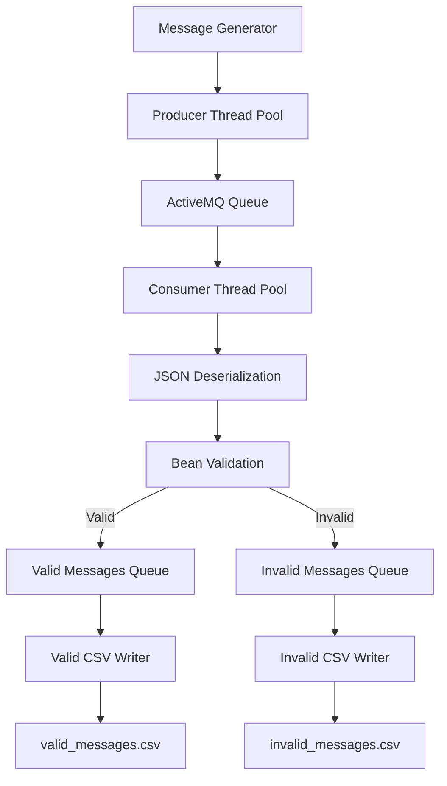

# Concurrent Message Processing Pipeline

A multithreaded Java application that generates messages, processes them through an ActiveMQ message queue, validates their contents, and writes valid and invalid records to separate CSV files.

Developed as part of the Java Backend course at SHPP School.

## Features

- Generate synthetic messages containing names, EDDR identifiers, counts, and timestamps.
- Send messages through an ActiveMQ queue using JMS.
- Process messages concurrently using producer and consumer thread pools.
- Validate message data using Jakarta Bean Validation.
- Implement custom validation constraints for names and EDDR identifiers.
- Route valid and invalid messages to separate processing queues.
- Export processed records to CSV files.
- Include validation errors in the output for invalid records.
- Collect processing statistics, including message counts, execution time, and throughput.
- Use poison-pill messages for coordinating the shutdown of consumers and CSV writers.

## Technologies

- **Java** — application logic and concurrency
- **ActiveMQ** — message broker
- **JMS** — asynchronous message communication
- **Jakarta Bean Validation** — data validation
- **Jackson** — JSON serialization and deserialization
- **Apache Commons CSV** — CSV file generation
- **SLF4J** — application logging
- **ExecutorService** — thread pool management
- **BlockingQueue** — thread-safe message routing

## Architecture

The application is organized into several cooperating components.

| Component | Responsibility |
|---|---|
| `Application` | Initializes and coordinates the processing pipeline |
| `MessageGenerator` | Generates synthetic message data |
| `Producer` | Serializes and sends messages to ActiveMQ |
| `Consumer` | Receives and deserializes messages |
| `MessageRouter` | Validates messages and routes them to the appropriate queue |
| `WriterCSV` | Writes valid and invalid records to CSV files |
| `ExecutorServiceManager` | Launches tasks and manages executor shutdown |
| `ProjectProperties` | Loads and validates application configuration |
| `MessagePOJO` | Represents a message and its validation errors |
| `CheckEddrValidator` | Validates the format and check digit of an EDDR identifier |
| `ContainsLetterValidator` | Checks whether a name contains a specified letter |
| `CSVPrinterFactory` | Creates configured CSV writers |

### Processing workflow



## Configuration

Create a `concurrent-message-processing-pipeline.properties` file in `src/main/resources/`:

```properties
url=tcp://localhost:61616
queue=messages
stop=600
```

| Property | Description |
|---|---|
| `url` | ActiveMQ broker connection URL |
| `queue` | Name of the JMS queue |
| `stop` | Maximum producer execution time in seconds |

The application also supports JVM system properties.

| System property | Default | Description |
|---|---|---|
| `count` | `1000000` | Maximum number of messages to generate |
| `username` | None | ActiveMQ connection username |
| `password` | None | ActiveMQ connection password |

The configured message count is distributed among the producer tasks. The `stop` property also limits how long each producer generates messages.

## Prerequisites

- A compatible Java Development Kit.
- Maven, if the project uses Maven for its build.
- An accessible ActiveMQ broker.
- The dependencies specified in the project build configuration.

## Running the Application

### 1. Start ActiveMQ

Start an ActiveMQ broker and ensure that it is accessible at the URL specified in `project3.properties`.

### 2. Configure the application

Create `concurrent-message-processing-pipeline.properties` under `src/main/resources/` and configure the broker URL, queue name, and producer time limit.

### 3. Build the project

If the project uses Maven:

```bash
mvn clean package
```

### 4. Run the application

Run the main class `com.zhbohdanchykov.Main` through your IDE or the project's configured Java launch command.

Example JVM options:

```bash
-Dcount=100000
-Dusername=your-username
-Dpassword=your-password
```

Configure credentials through your local run configuration or another suitable secret-management mechanism. Do not commit real credentials to the repository.

## Output

The application produces two CSV files in its working directory.

### `valid_messages.csv`

Contains records that pass validation.

```csv
name,count
Alexandra,120
```

### `invalid_messages.csv`

Contains records that fail validation, including the associated validation errors.

```csv
name,count,errors
InvalidName,5,"{""errors"":[""Count must be greater then 10.""]}"
```

The examples above illustrate the intended output structure; actual records and error messages depend on the generated data and validation rules.

## Processing Statistics

At the end of execution, the application reports:

- Total messages sent
- Total messages received
- Total messages written
- Total execution time
- Average message throughput in messages per second

These metrics can help evaluate the behavior of the pipeline under different message-count and execution-time configurations.

## Validation

Message validation includes standard constraints and custom validators.

- Required and non-blank names
- Minimum name length
- Presence of a specified letter in the name
- EDDR identifier format and check-digit validation
- Minimum message count
- Required creation timestamp

Messages that fail validation are routed to the invalid-message output together with their validation errors.

## Concurrency and Message Lifecycle

The application uses separate executor pools for producers, consumers, and CSV writers. Blocking queues transfer validated records to the output stage.

Poison-pill messages signal consumers and writers when processing should stop.

## Learning Objectives

This project demonstrates practical experience with:

- Multithreaded Java applications
- Executor services and concurrent collections
- Message-oriented communication using JMS
- ActiveMQ integration
- JSON serialization and deserialization
- Bean Validation and custom constraints
- CSV file processing
- Configuration management
- Graceful task termination and execution statistics